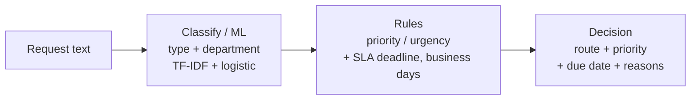

# pqrs-router

An intake router for citizen requests. It reads an incoming message, classifies
it into a PQRS type (petition, complaint, claim, suggestion, report) and a target
department, assigns a priority, and computes the statutory response deadline — a
single, explainable routing decision ready to drop into a public-sector workflow.

PQRS (Petición, Queja, Reclamo, Sugerencia) is the standard public-service intake
model across much of Latin America, where each request type carries a legal
response window. pqrs-router turns a free-text message into the structured
decision an agency needs to act on it in time.

[](.github/workflows/ci.yml)
[](pyproject.toml)
[](LICENSE)

---

## Why it matters

Public bodies receive large volumes of unstructured requests and are legally
bound to answer each one within a set period. Misrouting or missing a deadline
has real consequences. pqrs-router automates the triage:

- **Classify.** What kind of request is this, and which department owns it?
- **Prioritise.** How urgent is it — does it mention safety, health, an outage,
  fraud, or a vulnerable person?
- **Schedule.** By when must it be answered, counting only business days?
- **Explain.** Every decision carries the words that drove the classification and
  the reasons for the priority, and a low-confidence classification is flagged for
  manual triage rather than routed blindly.

No LLM and no network: the classifiers are small, fast, deterministic linear
models, which is the right tool for high-volume, auditable routing.

## How it works



1. **Classify (`classifier.py`).** Two logistic-regression models over a shared
   `FeatureUnion` of word (1-2 gram) and character (`char_wb`, 3-5) TF-IDF views
   predict the request type and the department, each with a confidence and the
   terms that drove the type decision. Character n-grams let the model recognise
   recurring stems (*invoice*, *connection*, *outage*) in wording it was not
   trained on.
2. **Rules (`rules.py`).** Priority starts from the request type and is raised to
   high when the text carries urgency. The deadline is the type's statutory window
   counted in business days from the received date.
3. **Route (`router.py`).** The two are combined into a `RoutingDecision`; a
   type confidence below the threshold marks the request uncertain for manual
   triage.

## Quick start

```bash
python -m venv .venv && source .venv/bin/activate
pip install -e ".[dev]"

# Classify and route a few sample requests:
python -m pqrs_router.cli demo

# Route one request:
python -m pqrs_router.cli route "I demand a correction of an incorrect charge."

# Run the HTTP API:
uvicorn pqrs_router.main:app --reload
```

Example API call:

```bash
curl -s -X POST localhost:8000/route -H 'content-type: application/json' -d '{
  "text": "There is a dangerous water leak on my street, it is urgent.",
  "received_date": "2026-01-05"
}'
```

## Configuration

Settings load from environment variables with the `PQ_` prefix (see
`.env.example`):

| Variable           | Default | Meaning                                              |
| ------------------ | ------- | ---------------------------------------------------- |
| `PQ_MIN_CONFIDENCE`| `0.45`  | Below this type confidence, flag for manual triage   |

The statutory response windows per request type live in `taxonomy.py`
(`SLA_BUSINESS_DAYS`); set them from the governing law for a real deployment.

## Evaluation: not the misleading 1.0

The classifiers are trained on synthetic requests. A random split of that set
would report ~1.0 accuracy — meaningless, because train and test would share the
same phrasings. So `pqrs_router.evaluation` runs a **phrase-disjoint split**: the
type openers, department topics, and type-context clauses are each partitioned,
and the test messages are built only from held-out phrasings, so the test wording
was never seen in training.

```
$ python -m pqrs_router.evaluation
Phrase-disjoint evaluation (test wording never seen in training):
  train / test size    : 1800 / 600
  type accuracy        : 0.965  (chance ~0.20)    # five types
  type train-test gap  : 0.035  (small = not overfit)
  department accuracy  : 0.892  (chance ~0.17)    # six departments
  department gap       : 0.108
```

These are the leakage-free generalisation figures, and the small gaps are the evidence
the models are neither underfit (scores far above chance) nor overfit (gaps are
bounded). Generalisation works because each label's signal is spread across
*recurring vocabulary* that the character n-grams pick up even in unseen phrasings.

### Validated on real complaints (CFPB)

The phrase-disjoint evaluation above measures generalisation to unseen *phrasings* of
synthetic requests. To show the same approach holds on real intake, the classifier's
exact pipeline (word + char TF-IDF + logistic regression) is benchmarked on a **real**
corpus — the U.S. Consumer Financial Protection Bureau consumer-complaint narratives
(via `fathyshalab/complaints`), routing a real complaint to its financial product, the
real analogue of routing a request to a department. A balanced 3,000-complaint, 10-class
slice is vendored under `datasets/complaints_real.jsonl` (see `datasets/README.md`). Run
`python -m pqrs_router.real_benchmark`:

```
samples        : 3000 across 10 product classes (chance 0.100, majority 0.100)
model          : word + char TF-IDF + logistic regression, C=0.3

CV accuracy    : 0.689 +/- 0.021
CV macro-F1    : 0.688
train / test   : 0.894 / 0.679  (gap 0.215)
shuffled labels: 0.111 CV accuracy (collapses to chance)

regularisation path (held-out accuracy is stable; the gap is train-side):
  C=0.2  train 0.868  test 0.676  gap 0.192
  C=2.0  train 0.992  test 0.685  gap 0.306

verdict: well-fit: strong, stable held-out accuracy well above chance
```

On real complaint narratives the classifier reaches **~0.69 held-out accuracy — about
seven times the 0.10 chance rate** on ten classes, and shuffling the labels collapses it
to 0.11, proving the signal is real. The regularisation path is the key evidence against
overfitting: held-out accuracy is flat (~0.68) from `C=0.2` to `C=2.0` while the
train/test gap grows, so the gap is the linear model memorising the training set, not
wasted generalisation — the real ceiling is the genuinely overlapping CFPB categories
(e.g. *Credit reporting* vs *Credit reporting, credit repair services…*). It is the same
approach that routes synthetic requests, now shown to carry over to messy real text.

## Testing

```bash
ruff check pqrs_router tests
pytest --cov=pqrs_router --cov-report=term-missing --cov-fail-under=80
```

The suite covers the classifiers (via the phrase-disjoint evaluation, asserting
both generalisation and bounded overfitting gaps), the rules (business-day
arithmetic, per-type SLAs, priority and urgency), the router (including the
uncertainty flag), the HTTP API, and the CLI.

## Documentation

- `docs/architecture.md` — the full picture and the data flow.
- `docs/adr/` — the main design decisions and why they were made.
- `docs/estudio/` — a study guide in Spanish, for learning the project in depth.

## License

[MIT](LICENSE) © Angelo David Padilla Romero
