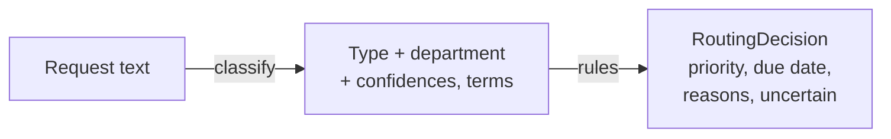

# Architecture

pqrs-router turns a free-text citizen request into a structured routing decision:
type, department, priority, and a statutory deadline. This document describes the
pieces, the data flow, and the boundaries between them.

## The pieces

| Layer          | Module                      | Responsibility                                          |
| -------------- | --------------------------- | ------------------------------------------------------- |
| Vocabulary     | `pqrs_router/taxonomy.py`   | Request types, departments, priorities, SLAs, urgency   |
| Data           | `pqrs_router/generate.py`   | Synthetic labelled requests for training                |
| Classifier     | `pqrs_router/classifier.py` | Request type + department (TF-IDF + logistic regression)|
| Rules          | `pqrs_router/rules.py`      | Priority and business-day deadlines                     |
| Router         | `pqrs_router/router.py`     | Combine classifier + rules into one decision            |
| Orchestration  | `pqrs_router/service.py`    | Fit the classifier and route                            |
| HTTP API       | `pqrs_router/main.py`       | Route requests over REST                                |
| CLI            | `pqrs_router/cli.py`        | Demo and single-request routing                         |

## Data flow

## Two decisions, two mechanisms

The design deliberately splits the work by what each part is good at.

- **What the request is** (type and department) is a **language** question, so it
  is learned from data with linear classifiers.
- **How it must be handled** (priority and deadline) is a **policy** question with
  legal weight, so it is encoded as deterministic rules — not learned, not
  guessed.

Keeping them apart means the statutory deadlines and the urgency policy are
auditable and change by editing data/law, while the classifier can be retrained
without touching the rules.

## The classifier

Two `LogisticRegression` models share one `TfidfVectorizer`: one predicts the
request type (five classes), the other the department (six classes). Linear models
are chosen for three reasons: they are fast and cheap at the volumes a public body
sees; they are deterministic; and they are explainable — a prediction is a
weighted sum of words, so the top contributing terms are the explanation. Each
prediction carries a confidence.

## The rules

- **Priority.** Each request type has a baseline priority (a report starts high, a
  suggestion low). Any request is raised to high when its text contains urgency
  terms — safety, health, outages, leaks, fraud, or vulnerable people. The reasons
  are recorded.
- **Deadline.** Each type has a statutory response window in **business days**
  (`SLA_BUSINESS_DAYS`). The due date is computed by adding that many business days
  to the received date, skipping weekends.

## The routing decision

`Router.route` classifies, applies the rules, and assembles a `RoutingDecision`
with the type, department, both confidences, the priority and its reasons, the
received and due dates, the SLA length, the explanation terms, and an `uncertain`
flag. When the type confidence is below the configured threshold, `uncertain` is
set so the request goes to a human for manual triage rather than being routed on a
weak guess — while the department and priority are still provided to help that
triage.

## Why no LLM and no blockchain

This is high-volume, latency-sensitive, auditable routing. A small linear model
classifies in microseconds, costs nothing per request, and can be explained line
by line; an LLM would add latency, cost, and opacity for no gain here. There is no
shared-ledger requirement either. The sound engineering choice is the simplest
tool that does the job well — and to say so.

## Extension points

- **SLAs.** `SLA_BUSINESS_DAYS` is plain data; set it from the governing law, and
  extend `add_business_days` to skip public holidays.
- **Urgency.** `URGENCY_TERMS` is a plain list; tune it per agency.
- **Departments / types.** Add to the enums and the training templates.
- **Classifier.** The linear models can be swapped for a stronger text model
  behind the same `classify` interface without touching the rules or the router.
