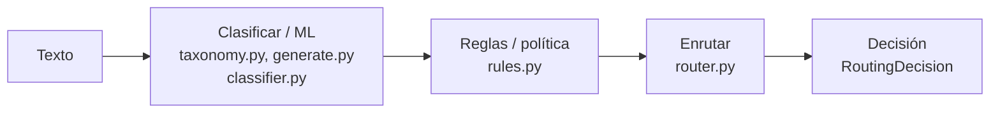

# 04 — Arquitectura y decisiones de diseño

## Las piezas, de principio a fin

Por encima: la **API HTTP** (`main.py`, FastAPI) y la **CLI** (`cli.py`, demo y
enrutamiento de una solicitud).

## Decisión 1: separar lo aprendido de la política

Una decisión de enrutamiento mezcla dos juicios distintos:

- **Qué es la solicitud** (tipo, departamento): un problema de lenguaje → se
  **aprende** con modelos lineales.
- **Cómo atenderla** (prioridad, plazo): política con peso legal → **reglas
  deterministas**.

Si todo fuera un modelo, los plazos quedarían implícitos en su comportamiento:
imposibles de auditar. Si todo fueran reglas, la clasificación sería frágil.
Separarlos mantiene la parte con consecuencias legales revisable, y la parte que
se beneficia de aprender, entrenable.

## Decisión 2: modelos lineales, no un LLM

Explicada en la guía 01. Rápidos, deterministas, explicables, sin dependencia
externa: lo adecuado para intake de alto volumen y auditable. La interfaz permite
cambiar a un modelo más potente si hiciera falta.

## Decisión 3: umbral de confianza → revisión humana

Explicada en la guía 03. La baja confianza de tipo marca `uncertain` y deriva a un
humano, pero aporta departamento, prioridad y plazo. La urgencia actúa igual.

## Decisión 4: plazos en días hábiles por tipo

Explicada en la guía 02. Los plazos legales se cuentan en días hábiles; el cálculo
salta fines de semana. Los festivos son una extensión en `add_business_days`.

## Por qué aquí NO hay LLM ni blockchain

Este es un enrutamiento de alto volumen, sensible a latencia y coste, y auditable.
Un modelo lineal clasifica en microsegundos, no cuesta por solicitud y se explica
línea a línea; un LLM añadiría latencia, coste y opacidad sin ganancia. Tampoco
hay necesidad de un registro compartido inmutable. La ingeniería sensata es usar
la herramienta más simple que resuelve bien el problema — y decirlo. No todos los
proyectos del portafolio necesitan las mismas tecnologías.

## Configuración por entorno

`config.py` con prefijo `PQ_`: `PQ_MIN_CONFIDENCE` (umbral de incertidumbre). Los
plazos (`SLA_BUSINESS_DAYS`) y los términos de urgencia (`URGENCY_TERMS`) viven en
`taxonomy.py`, listos para fijarlos desde la ley y la realidad de cada entidad.

## Puntos de extensión

- **SLAs:** fijar `SLA_BUSINESS_DAYS` desde la ley; añadir festivos en
  `add_business_days`.
- **Urgencia:** ajustar `URGENCY_TERMS` por entidad.
- **Departamentos/tipos:** ampliar los enums y las plantillas de entrenamiento.
- **Clasificador:** cambiarlo por un modelo de texto más fuerte tras la misma
  interfaz, sin tocar reglas ni router.

## Para fijar la idea

- Capas: clasificar (ML) → reglas (política) → enrutar.
- Cuatro decisiones: separar aprendido/política, lineales no LLM, umbral→revisión,
  plazos en días hábiles.
- Sin LLM ni blockchain a propósito: la herramienta adecuada para el problema.
